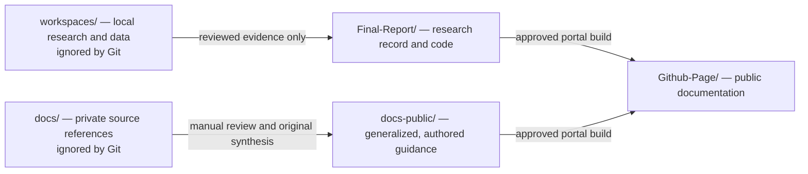
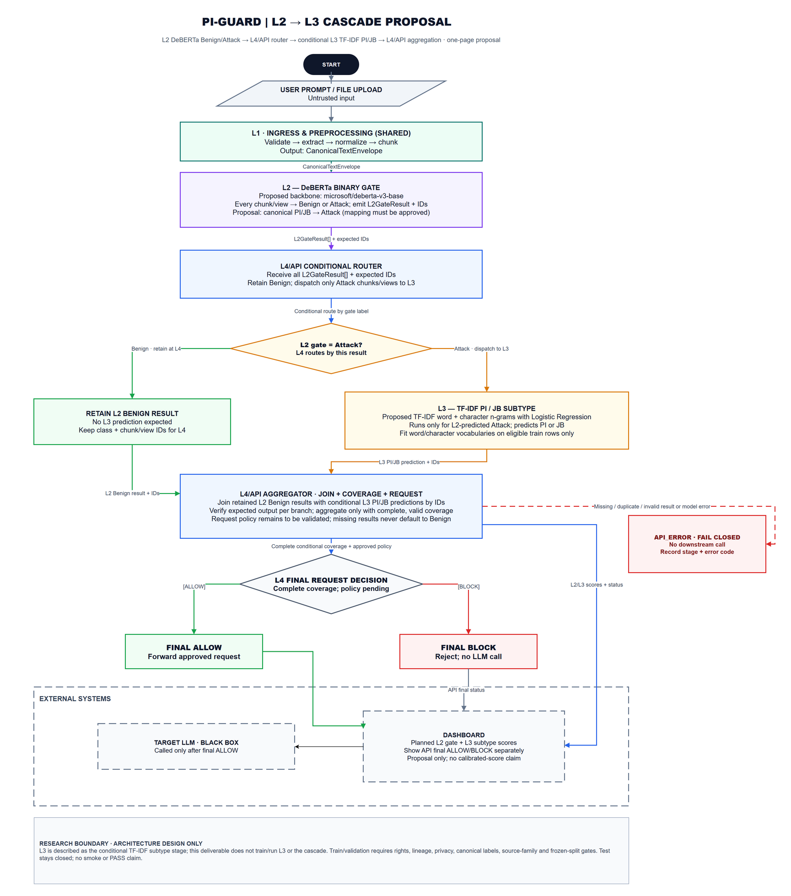

# PI-Guard

A machine-learning guardrail for detecting prompt injection and jailbreak attacks on LLM applications. PI-Guard is an academic capstone project at FPT University (IAP491), currently working through Review 2.

## Current project state — 19 October 2026

Review 2 is active. Continued model research is organized in the local-only workspace `workspaces/truongnv/pi_guard_l2_deberta_gate_tfidf_subtype/`. The earlier `pi_guard_pipeline` workspace records prior exploration; use the DeBERTa gate/subtype workspace for new model research. Model artifacts, prompt payloads, and experiment runs remain local-only until reviewed and approved for a tracked deliverable.

## Project and repository timeline

The timeline separates research milestones from repository changes. Proposed components remain proposals until implemented and supported by measured evidence.

| Period | Research and architecture | Repository state |
|---|---|---|
| 29 August–3 September 2026 | Project kickoff and initial problem framing: inspect requests at an application boundary before forwarding them to a downstream language model. | The repository began on 1 September. The research record and documentation portal were established during the first week. |
| 4–10 September 2026 | Literature review, prompt injection and jailbreak taxonomy, threat model, and Review 1 scope. | The repository was reorganized around `Final-Report/` for shared research records, `Github-Page/` for public documentation, and `workspaces/` for local work. |
| 11 September–3 October 2026 | Review 1 research refined the proposed ingress flow: normalize and split input, score chunks, route uncertain cases for deeper review, and aggregate a request-level decision. | Research reports and the public portal recorded the proposal and its limits. Review 1 concluded on 3 October; the flow remains a proposal. See the [public threat model](Github-Page/thesis/review1_threat_model.md) and [ingress architecture](Github-Page/models/ingress_architecture.md). |
| 5 October 2026 | The proposed ingress diagram and its public preview were synchronized. | The editable diagram and canonical image were consolidated under `Final-Report/reports/`. |
| 9 October 2026 | Review 2 preparation: a candidate dataset split was versioned. Label review, model training, real inference, and held-out evaluation remained open. | The repository contains the split-generation and verification code plus manifests; data payloads stay local. See the [dataset status](Github-Page/dataset_study/dataset_initialization_v5.md). |
| 17–19 October 2026 — current | Model research continues in a dedicated DeBERTa L2 gate and TF-IDF subtype workspace. | The earlier `pi_guard_pipeline` is retained as prior exploration. Current task scope and run evidence stay in the local-only workspace; this README records the research direction, not model acceptance. |
| Next | Continue the task recorded in the active model workspace, keeping dataset readiness, model fits, validation, test use, and acceptance as separate evidence states. | Promote only reviewed evidence into `Final-Report/`, then synchronize its approved public summary to `Github-Page/`. |

## Repository architecture

The portal builder does not read from private `docs/` or publish local workspace content. `docs-public/` contains project-authored general guidance, not copies of the private source documents.

## Model architecture under current research

The active model track separates attack detection from subtype classification:

Source: the local-only workspace file `workspaces/truongnv/pi_guard_l2_deberta_gate_tfidf_subtype/PI_GUARD_L2_DEBERTA_GATE_TFIDF_SUBTYPE.drawio`. Its L3 label reflects the active TF-IDF word + character n-gram Logistic Regression baseline. The PNG is a visual export; the editable Draw.io source remains local-only.

L3 classifies only items routed as Attack by L2; it cannot recover an attack missed by L2. The intended output is Benign / Prompt Injection (PI) / Jailbreak (JB). This is the current research design, not a claim that the model or full cascade has passed training, validation, test, or acceptance gates. Dataset readiness, model fitting, evaluation, and acceptance require separate evidence.

The [Review 1 ingress diagram](Final-Report/reports/PI_GUARD_INGRESS_ARCHITECTURE.png) and its [editable Draw.io source](Final-Report/reports/PI_GUARD_INGRESS_ARCHITECTURE.drawio) remain as historical project-level context. They describe an earlier ingress/API proposal and do not define the active model research track or establish performance cutoffs.

The [ISO 5807:1985 symbol audit](Final-Report/reports/ISO_5807_1985_SYMBOL_AUDIT.md) documents the flowchart shapes, icon conventions, and the limits of the available standards preview.

## Repository map

- [Final-Report](Final-Report/README.md): shared academic deliverables and official progress materials.
- [workspaces](workspaces/README.md): explains the local-only workspace policy; no personal workspace is published here.
- [Documentation portal](Github-Page/index.md): project introduction and research topics.
- [Project governance](AGENTS.md): scope, provenance, and repository maintenance rules.

## Repository maintainer

Nguyễn Văn Trường (`nvtruongops`) is the sole current maintainer and publisher of this repository. `Final-Report/` and `Github-Page/` contain the group capstone progress reports and research outcomes that he consolidates and publishes. Member names in those reports record project progress; they do not mean those members currently maintain or contribute to this Git repository. Ongoing model research, notes, experiments, and drafts stay in the ignored local workspace `workspaces/truongnv/pi_guard_l2_deberta_gate_tfidf_subtype/`. The original Git history and its author records are preserved on `archive/pre-single-contributor-main-20261019`; `main` is a single-maintainer snapshot pointing to the current repository contents.

## Documentation portal

Install the repository dependencies, then run the portal builder and strict site build from the repository root:

    python Final-Report/scripts/build_docs_portal.py
    mkdocs serve
    mkdocs build --strict

The documentation source and deployment workflow are described in [Github-Page/README.md](Github-Page/README.md).
